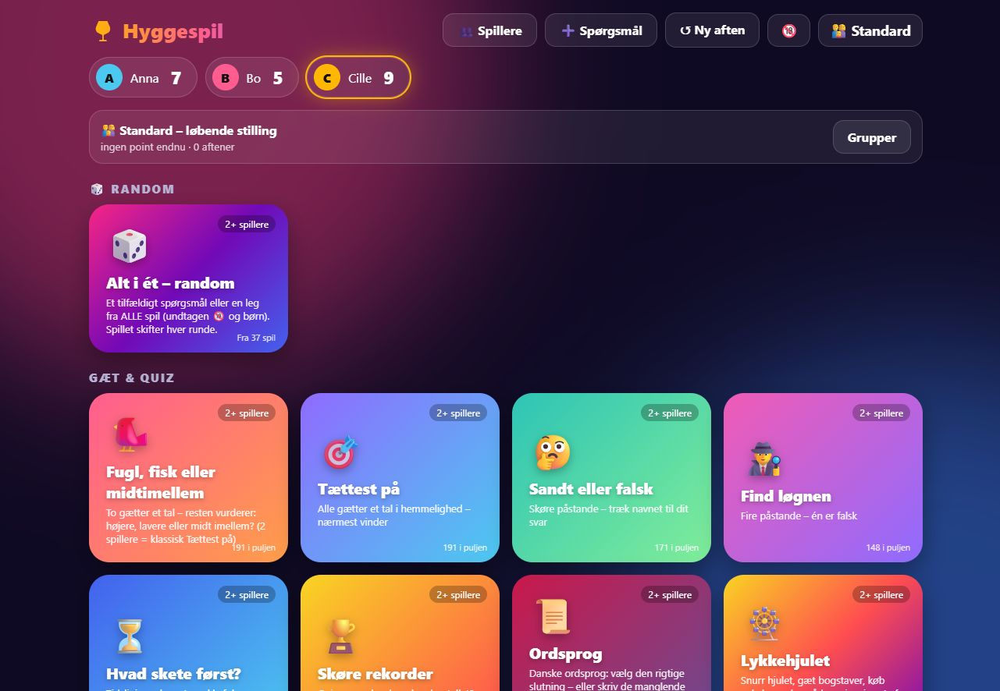

# 🍷 Hyggespil

Danske selskabsspil til Home Assistant: quiz, gåder, lege og udfordringer til én fælles skærm – tablet, tv eller telefon.
Spillet kører lokalt i din Home Assistant og bruger ingen konto, sky eller eksterne tjenester.

**Udvikler:** Allan Persson · **Licens:** MIT · **Version:** 0.1.0-beta.1 (beta)

## Indhold

83 spil og over 6.000 spørgsmål, opgaver og kort på dansk:

| Gruppe | Spil |
|---|---|
| Gæt & quiz | Fugl, fisk eller midtimellem · Tættest på · Sandt eller falsk · Find løgnen · Hvad skete først? · Skøre rekorder · Ordsprog · Lykkehjulet · Danske love & regler |
| Mysterie & hjernevrid | Hvem gjorde det? · Gåder · Hvem/hvad er jeg? |
| Party & leg | Forbudte ord · Gæt og vis · Hellere end · Mest sandsynlig til… · Jeg har aldrig… · Vinudfordringer · Stormester |
| Hygge & dybde | Dybe samtaler |
| Geografi & ord | I hvilket land ligger byen? · Sæt knappenålen (3D-globus) · Postnummer-quiz · Mærkelige ord · Hvilket sprog? · Destination: hvor er vi? |
| 🚦 Færdselsloven | Bil · Cykel · Fodgænger · Alle trafikanter |
| 🌍 Spil fra hele verden | Shiritori · Yut Nori · Suit Jawa · Shagai · Inuit-vinterlege · Lotería |
| 🦑 Squid Games | Rødt lys, grønt lys · Glasbroen · Kugler: lige eller ulige · Dalgona-udfordringer · Dystre valg · Hvem i familien? |
| 🧒 Børn & unge | Hvilket dyr er jeg? · Gør som dyret · Børnegåder · Børnequiz · Gæt og vis · Ord og rim · Hvad ville du helst? · Sandt eller falsk · Hvad hører ikke til? · Tæl og gæt · Mest sandsynlig |
| 🔐 Kodespil | Zodiac-glyfer · Gridskrift · Punktskrift · Farver · Morse · Cæsars brev · Spejlbrev · Bogstavkæde |
| 🔤 Ordspil | Ord af bogstaver · Ordkæde · Ordtrappe · Ordsplit · Baglæns · Rim · Længste ord · Stavboks · Staveling |
| 🧮 Tal & matematik | Tænk et tal · Hovedregning · Talrækker · Overslag · Procent · Sanseprøve · Ur & tid · Bogstavværdi |
| 🎲 Random | Alt i ét · Random børnespil |
| 🔞 Kun for voksne | Romantik · Sexy udfordringer · Grænseløs · Intime spørgsmål · Jeg har aldrig 🔞 · Random 🔞 |

Desuden: point og stilling, grupper med løbende stilling fra aften til aften, og mulighed for at fortsætte et afbrudt spil.

### ⏱️ Timer, hurtige svar og spænding i lyset
Inden et spil starter kan du vælge en **nedtælling** (fx 30 eller 60 sekunder pr. spørgsmål),
**ekstra point for et hurtigt svar** og et **lokalt musikstykke**, der spiller de sidste sekunder.
Undervejs ændrer du det med ⚙ i spillets bjælke.

Integrationen opretter sensoren **`sensor.hyggespil_spil`**, så lyset kan pulsere, jo tættere på
udløb man er – der følger et blueprint med. Se [docs/spaending.md](docs/spaending.md) for
sensorens attributter, blueprintet og eksempler på automatiseringer.

### Børn og alder
Skriv alder på spillerne under **👥 Spillere**. Så sker der dette:

- Hvert barn (til og med 14 år) får spørgsmål på sit eget niveau. Spiller en 8-årig mod en 4-årig, får de hver sin runde.
- Niveauet følger med: 4 rigtige af de seneste 5 svar gør spørgsmålene sværere, højst 1 rigtigt af 5 gør dem lettere.
- Børn og voksne i samme gruppe skiftes til børnerunder og voksenrunder.
- Er der en spiller under 18 år, vises 🔞 slet ikke. Voksenspil, der ikke kan tilpasses børn, ligger nederst og er nedtonet.

### 🔞-sektionen
Sektionen er skjult, til man låser den op med **en kode, man selv vælger** (4–8 cifre) første gang på hver enhed.
Der findes ingen fælles kode. Koden gemmes ikke i klartekst – kun som en kontrolsum i browseren på enheden – og kan nulstilles dér.

Bemærk: koden skjuler sektionen i spillet, men teksterne ligger i spillets filer ligesom alt andet indhold. Se [SECURITY.md](SECURITY.md).

## Installation

Kræver Home Assistant 2024.12 eller nyere.

1. Åbn **Marketplace** (i ældre versioner: **HACS**) og tilføj dette repository som brugerdefineret repository:
   `https://github.com/allanpersson/hyggespil` – type **Integration**.
2. Find **Hyggespil** og hent det. Versionen er en beta: slå «pre-release» til for repositoriet, eller vælg `0.1.0-beta.1` som version.
3. Genstart Home Assistant.
4. Gå til **Indstillinger → Enheder og tjenester → Tilføj integration**, og vælg **Hyggespil**.

Herefter ligger **Hyggespil** i sidebjælken.

Ny version? Jeg udgiver en prerelease med den rigtige zip-fil, hver gang jeg hæver versionen i
`custom_components/hyggespil/manifest.json` – du henter den samme vej igen.

Fejler downloaden hos dig (fx "no usable manifest.json"), så følg [installationsguiden for fejlfinding](docs/installation-fejl.md).

**Uden Marketplace/HACS:** kopiér mappen `custom_components/hyggespil` til `config/custom_components/` i din Home Assistant, genstart, og tilføj integrationen som i trin 4.

Vil du have spillet på et dashboard, kan du bruge et websidekort med adressen `/hyggespil_files/hs.html`.

## Første gang du åbner spillet

Et velkomstvindue beder dig om at vælge din egen 🔞-kode (4–8 cifre) og viser to forudoprettede spillere
(Spiller 1 og Spiller 2) i gruppen Standard. Du kan ændre navne, aldre og antal med det samme. Intet fra
udviklerens eget spil – ingen navne, point, svarede spørgsmål eller gemte spil – følger med installationen.

## Privatliv

- Spillernavne, aldre, point, grupper og egne spørgsmål gemmes kun i browseren på den enhed, I spiller på. Der er ingen konto og ingen server ud over din egen Home Assistant.
- Spillet henter intet fra internettet: ingen skrifttyper, statistik eller reklamer.
- Spillets filer ligger på `/hyggespil_files/` i din Home Assistant og kan – ligesom filer i `/local/` – læses uden login af dem, der kan nå din Home Assistant. Filerne indeholder kun selve spillet, ingen oplysninger om jer.

Mere i [SECURITY.md](SECURITY.md).

## Feedback

Hvert spil har en **💬-knap**. Skriv, hvad der er galt eller kunne blive bedre, og tryk **Åbn sag på GitHub**: så åbnes en færdigudfyldt sag i dette repository, som du selv sender (kræver en GitHub-konto). Du kan også kopiere teksten.

Spillet sender aldrig noget af sig selv. Sagen indeholder din tekst, spillets navn og – hvis du lader fluebenet stå – version, browser og antal spillere. Aldrig navne, aldre eller point.

## Kilder og fakta

Faktaspørgsmål (tal, rekorder, geografi, sprog, love og færdselsregler) er kontrolleret mod skriftlige kilder: mindst to uafhængige kilder pr. punkt, og for love selve lovteksten. Fejl kan stadig forekomme, og love ændres. Mener du, et svar er forkert, så brug 💬 i spillet og skriv gerne kilden.

## Kendte begrænsninger i betaen

- Afprøvet i Chromium på pc. Telefon, tablet og Home Assistant-appen er ikke gennemtestet.
- Den automatiske sværhedsgrad gælder kun børn; voksenspørgsmålene har ingen sværhedsgrader.
- Der er færrest børnespørgsmål til 3–5 år og 11–13 år.
- Alle spiller på samme skærm; der er ingen synkronisering mellem enheder.
- Spillet findes kun på dansk.

## Udvikling

Se [CONTRIBUTING.md](CONTRIBUTING.md). Tredjepartsindhold: [THIRD_PARTY_NOTICES.md](THIRD_PARTY_NOTICES.md).
