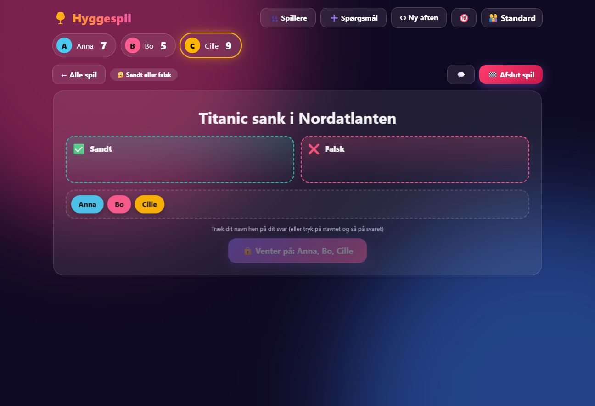

# 🍷 Hyggespil

Danske selskabsspil til Home Assistant: quiz, gåder, lege og udfordringer til én fælles skærm – tablet, tv eller telefon.
Spillet kører lokalt i din Home Assistant og bruger ingen konto, sky eller eksterne tjenester.

**Udvikler:** Allan Persson · **Licens:** MIT

<!-- version:start -->
**Version:** 0.2.4
<!-- version:end -->


## Indhold

83 spil og over 6.400 spørgsmål, opgaver og kort på dansk:

| Gruppe | Spil |
|---|---|
| Gæt & quiz | Fugl, fisk eller midtimellem · Tættest på · Sandt eller falsk · Find løgnen · Hvad skete først? · Skøre rekorder · Ordsprog · Lykkehjulet · Danske love & regler |
| Mysterie & hjernevrid | Hvem gjorde det? · Gåder · Hvem/hvad er jeg? |
| Party & leg | Forbudte ord · Gæt og vis · Hellere end · Mest sandsynlig til… · Jeg har aldrig… · Vinudfordringer · Stormester |
| Hygge & dybde | Dybe samtaler |
| Geografi & ord | I hvilket land ligger byen? · Sæt knappenålen (3D-globus) · Postnummer-quiz · Mærkelige ord · Hvilket sprog? · Destination: hvor er vi? |
| 🚦 Færdselsloven | Bil · Cykel · Fodgænger · Alle trafikanter |
| 🌍 Spil fra hele verden | Shiritori · Yut Nori · Suit Jawa · Shagai · Inuit-vinterlege · Lotería |
| 🦑 Squid Games | Rødt lys, grønt lys · Glasbroen · Kugler: lige eller ulige · Dalgona-udfordringer · Dystre valg · Hvem i familien? |
| 🧒 Børn & unge | Hvilket dyr er jeg? · Gør som dyret · Børnegåder · Børnequiz · Gæt og vis · Ord og rim · Hvad ville du helst? · Sandt eller falsk · Hvad hører ikke til? · Tæl og gæt · Mest sandsynlig |
| 🔐 Kodespil | Zodiac-glyfer · Gridskrift · Punktskrift · Farver · Morse · Cæsars brev · Spejlbrev · Bogstavkæde |
| 🔤 Ordspil | Ord af bogstaver · Ordkæde · Ordtrappe · Ordsplit · Baglæns · Rim · Længste ord · Stavboks · Staveling |
| 🧮 Tal & matematik | Tænk et tal · Hovedregning · Talrækker · Overslag · Procent · Sanseprøve · Ur & tid · Bogstavværdi |
| 🎲 Random | Alt i ét · Random børnespil |
| 🔞 Kun for voksne | Romantik · Sexy udfordringer · Grænseløs · Intime spørgsmål · Jeg har aldrig 🔞 · Random 🔞 |

Desuden: point og stilling, grupper med løbende stilling fra aften til aften, og mulighed for at fortsætte et afbrudt spil.



### ⏱️ Timer, hurtige svar og spænding i lyset

Når du vælger et spil, åbner en boks **inden spillet starter** (og igen med **⚙** i spillets bjælke):

- **Tid pr. spørgsmål** – ingen, 30, 45, 60, 90, 120 sekunder eller din egen tid. Nedtællingen vises
  nederst til højre med en ring, der skifter fra blå til gul til rød; ved udløb bipper den og blinker.
  Den bruges ikke i bræt-, terning- og 3D-spillene, hvor en tid pr. spørgsmål ikke giver mening.
- **Ekstra point for hurtigt svar** – 0-3 point, hvis svaret kommer inden for det valgte antal sekunder
  (standard 10). Pointene gives én gang pr. spiller pr. spørgsmål.
- **Spændingsmusik** – vælg en lydfil fra din enhed (maks. 8 MB). Den spiller de sidste sekunder af
  nedtællingen og stopper, når tiden er gået. Filen gemmes kun på den enhed, I spiller på, og kræver
  en valgt tid. Browseren kræver et klik før lyd – det klik, du giver ved «Start spil», tæller.

Valgene huskes til næste gang.

#### Sensor og automationer

Integrationen opretter **`sensor.hyggespil_spil`** (`klar` / `spiller` / `slut`) med attributterne
`spil`, `spil_navn`, `spillere`, `sekunder`, `tid`, `urgency` (0 → 1), `puls` (0 → 1), `musik` og
`opdateret`. Den opdateres cirka én gang i sekundet, mens der spilles, og der sendes også hændelsen
`hyggespil_spil_status`. Tjenesten `hyggespil.status` kan kaldes manuelt fra Udviklerværktøjer.

**Blueprint** «Hyggespil – spænding i lyset» får lyset til at pulsere som et hjertebank: både
hastigheden og forskellen mellem svag og kraftig lysstyrke stiger, jo tættere på udløb man er.
Importér det under **Indstillinger → Automatiseringer og scener → Blueprints → Importér blueprint**:

```
https://github.com/allanpersson/hyggespil/blob/main/blueprints/automation/hyggespil/spaending.yaml
```

Eksempel på egen automation (lysstyrke styret af pulsslaget):

```yaml
triggers:
  - trigger: state
    entity_id: sensor.hyggespil_spil
    to: "spiller"
actions:
  - repeat:
      while:
        - condition: state
          entity_id: sensor.hyggespil_spil
          state: "spiller"
      sequence:
        - action: light.turn_on
          target:
            entity_id: light.stue
          data:
            brightness_pct: "{{ (15 + 85 * state_attr('sensor.hyggespil_spil','puls') | float(0)) | round(0) }}"
            rgb_color: [255, 60, 90]
        - delay:
            milliseconds: >-
              {{ (1000 - 800 * state_attr('sensor.hyggespil_spil','urgency') | float(0)) | round(0) }}
```

Alle detaljer, attributoversigt og flere eksempler: [docs/spaending.md](docs/spaending.md).

### Børn og alder
Skriv alder på spillerne under **👥 Spillere**. Så sker der dette:

- Hvert barn (til og med 14 år) får spørgsmål på sit eget niveau. Spiller en 8-årig mod en 4-årig, får de hver sin runde.
- Niveauet følger med: 4 rigtige af de seneste 5 svar gør spørgsmålene sværere, højst 1 rigtigt af 5 gør dem lettere.
- Børn og voksne i samme gruppe skiftes til børnerunder og voksenrunder.
- Er der en spiller under 18 år, vises 🔞 slet ikke. Voksenspil, der ikke kan tilpasses børn, ligger nederst og er nedtonet.

### 🔞-sektionen
Sektionen er skjult, til man låser den op med **en kode, man selv vælger** (4–8 cifre) første gang på hver enhed.
Der findes ingen fælles kode. Koden gemmes ikke i klartekst – kun som en kontrolsum i browseren på enheden – og kan nulstilles dér.

Bemærk: koden skjuler sektionen i spillet, men teksterne ligger i spillets filer ligesom alt andet indhold. Se [SECURITY.md](SECURITY.md).

## Installation

Kræver Home Assistant 2024.12 eller nyere.

1. Åbn **Marketplace** (i ældre versioner: **HACS**) og tilføj dette repository som brugerdefineret repository:
   `https://github.com/allanpersson/hyggespil` – type **Integration**.
2. Find **Hyggespil** og hent den nyeste version (`0.2.3` eller senere). Der er ingen prereleases –
   Marketplace viser den nyeste almindelige udgivelse.
3. Genstart Home Assistant.
4. Gå til **Indstillinger → Enheder og tjenester → Tilføj integration**, og vælg **Hyggespil**.

Herefter ligger **Hyggespil** i sidebjælken, og sensoren `sensor.hyggespil_spil` dukker op.

Ny version? Den udgives automatisk, når spillets indhold eller kode ændrer sig (dagligt om morgenen),
som en almindelig `x.x.x`-udgivelse med den zip-fil, Marketplace bruger. Du henter den samme vej igen.

Fejler downloaden hos dig (fx "no usable manifest.json"), så følg [installationsguiden for fejlfinding](docs/installation-fejl.md).

**Uden Marketplace/HACS:** hent `hyggespil.zip` fra den [nyeste udgivelse](https://github.com/allanpersson/hyggespil/releases/latest),
pak den ud i `config/custom_components/hyggespil/` (så `manifest.json` ligger direkte i mappen), genstart,
og tilføj integrationen som i trin 4.

Vil du have spillet på et dashboard, kan du bruge et websidekort med adressen `/hyggespil_files/hs.html`.

## Første gang du åbner spillet

Et velkomstvindue beder dig om at vælge din egen 🔞-kode (4–8 cifre) og viser to forudoprettede spillere
(Spiller 1 og Spiller 2) i gruppen Standard. Du kan ændre navne, aldre og antal med det samme. Intet fra
udviklerens eget spil – ingen navne, point, svarede spørgsmål eller gemte spil – følger med installationen.

## Privatliv

- Spillernavne, aldre, point, grupper og egne spørgsmål gemmes kun i browseren på den enhed, I spiller på. Der er ingen konto og ingen server ud over din egen Home Assistant.
- Spændingsmusik gemmes også kun på enheden (i browserens IndexedDB) og uploades ikke.
- Spillets tilstand (spil, sekunder, puls) sendes kun til din egen Home Assistant via tjenesten `hyggespil.status` – aldrig ud af huset.
- Spillet henter intet fra internettet: ingen skrifttyper, statistik eller reklamer.
- Spillets filer ligger på `/hyggespil_files/` i din Home Assistant og kan – ligesom filer i `/local/` – læses uden login af dem, der kan nå din Home Assistant. Filerne indeholder kun selve spillet, ingen oplysninger om jer.

Mere i [SECURITY.md](SECURITY.md).

## Feedback

Hvert spil har en **💬-knap**. Skriv, hvad der er galt eller kunne blive bedre, og tryk **Åbn sag på GitHub**: så åbnes en færdigudfyldt sag i dette repository, som du selv sender (kræver en GitHub-konto). Du kan også kopiere teksten.

Spillet sender aldrig noget af sig selv. Sagen indeholder din tekst, spillets navn og – hvis du lader fluebenet stå – version, browser og antal spillere. Aldrig navne, aldre eller point.

## Kilder og fakta

Faktaspørgsmål (tal, rekorder, geografi, sprog, love og færdselsregler) er kontrolleret mod skriftlige kilder: mindst to uafhængige kilder pr. punkt, og for love selve lovteksten. Fejl kan stadig forekomme, og love ændres. Mener du, et svar er forkert, så brug 💬 i spillet og skriv gerne kilden.

## Kendte begrænsninger

- Afprøvet i Chromium på pc. Telefon, tablet og Home Assistant-appen er ikke gennemtestet.
- Den automatiske sværhedsgrad gælder kun børn; voksenspørgsmålene har ingen sværhedsgrader.
- Der er færrest børnespørgsmål til 3–5 år og 11–13 år.
- Alle spiller på samme skærm; der er ingen synkronisering mellem enheder.
- Spillet findes kun på dansk.
- Sensoren og blueprintet er testet som kode og YAML, men ikke i en kørende Home Assistant endnu.
  Musikafspilning kræver, at browseren har fået et klik (det gør «Start spil»).

## Nyheder

<!-- nyheder:start -->
### 0.2.3 – 2026-11-14

**Tilføjet**
- ⏱️ **Nedtælling pr. spørgsmål** – vælg 30/45/60/90/120 sekunder eller din egen tid, før spillet starter. Ringen nederst skifter fra blå til gul til rød og bipper ved udløb.
- ⚡ **Ekstra point for hurtigt svar** – 0-3 point, hvis svaret falder inden for det valgte antal sekunder (én gang pr. spiller pr. spørgsmål).
- 🎵 **Spændingsmusik** – en lokal lydfil, der spiller de sidste sekunder af nedtællingen. Gemmes kun på enheden (maks. 8 MB).
- 📡 **`sensor.hyggespil_spil`** med `spil`, `sekunder`, `tid`, `urgency`, `puls`, `spillere` og `musik`, plus tjenesten `hyggespil.status` og hændelsen `hyggespil_spil_status`.
- 🔆 **Blueprint** «Hyggespil – spænding i lyset»: lyset pulserer med stigende hastighed og udsving, jo tættere på udløb man er.
- 📖 [docs/spaending.md](docs/spaending.md) med opsætning, attributter og egne automatiseringer.

**Ændret**
- README viser nu altid den installerede version og ændringslogen for de nyeste udgivelser – den opdateres automatisk ved hver udgivelse.

### 0.2.2 – 2026-11-14

**Rettet**
- hassfest afviste manifestet («Domain is missing an IoT Class») – `iot_class: calculated` er tilbage.
- CI skubber robust (rebase og gentag), og synkroniseringen laver ét commit i stedet for ét pr. fil.
- Ny overvågning af filer, udgivelse og CI (`tools/overvaag.js`).

### 0.2.1 – 2026-11-14

**Rettet**
- Versionsnummeret nederst på spillets forside følger nu udgivelsen.

### 0.2.0 – 2026-11-14

**Rettet**
- **Marketplace/HACS kunne ikke installere**: udgivelseszippet var pakket ind i `custom_components/hyggespil/`, men udpakkes direkte i `custom_components/hyggespil`. Nu ligger `manifest.json` i zippets rod.
- Versioner er rene `x.x.x` (ikke prereleases), så Marketplace viser en version i stedet for en commit-SHA.
- Nye CI-tjek: `tools/tjek_installation.py` (udpakker som Marketplace/HACS) og `tools/tjek_manifest.py` (hassfests regler).

[Hele ændringsloggen](CHANGELOG.md) · [alle udgivelser](https://github.com/allanpersson/hyggespil/releases)
<!-- nyheder:end -->

## Udvikling

Se [CONTRIBUTING.md](CONTRIBUTING.md). Tredjepartsindhold: [THIRD_PARTY_NOTICES.md](THIRD_PARTY_NOTICES.md).
